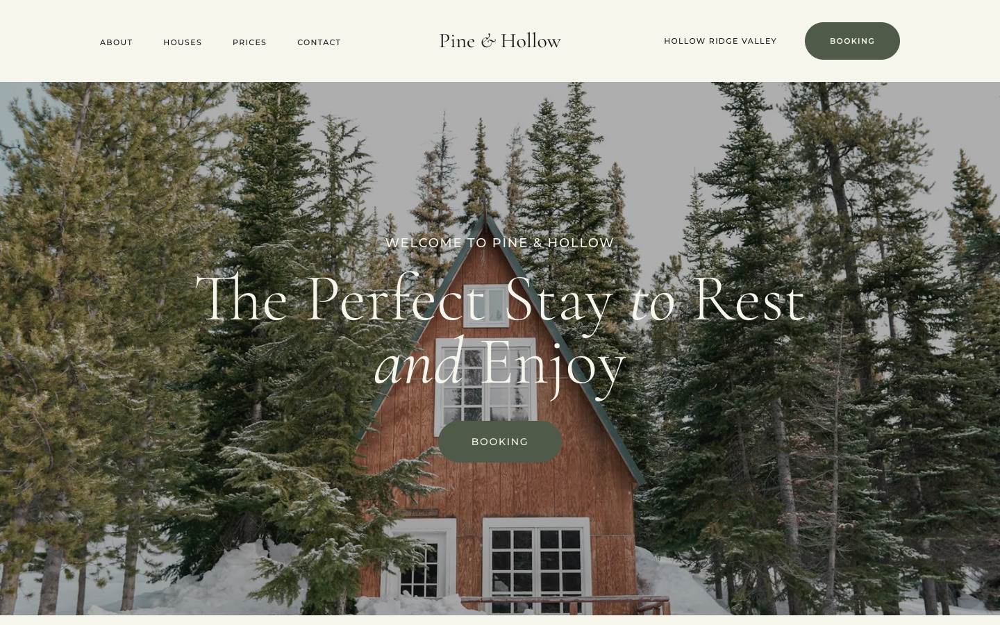
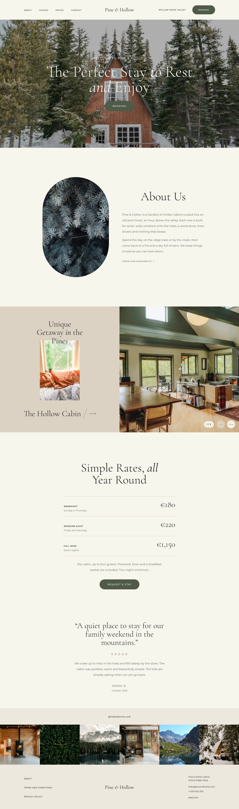

# Pine & Hollow

A one-page landing site for a forest-cabin retreat in the mountains, built with Astro and Tailwind CSS v4.



<details>
<summary>Full-page screenshot</summary>



</details>

## Stack

- [Astro](https://astro.build) with static output and no UI framework
- [Tailwind CSS v4](https://tailwindcss.com), with design tokens in `@theme`
- `astro:assets` `<Image />` for responsive, optimised images
- Cormorant Garamond and Montserrat, self-hosted via [Fontsource](https://fontsource.org)

## Structure

```text
src/
├── assets/        photos (credits in CREDITS.md)
├── components/    one component per section: Header, Hero, About, Getaway,
│                  Prices, Testimonial, InstagramStrip, Footer
├── data/site.ts   all copy, links and image references
├── layouts/       Base.astro: <head>, meta, fonts
└── pages/         index, privacy, terms
```

The components only handle presentation. All content lives in `src/data/site.ts`.

## Run locally

Requires Node 22+.

```sh
npm install
npm run dev       # http://localhost:4321
npm run build     # static output in dist/
npm run preview
```

## Credits

The photos come from Unsplash. See [CREDITS.md](CREDITS.md) for each photographer.
